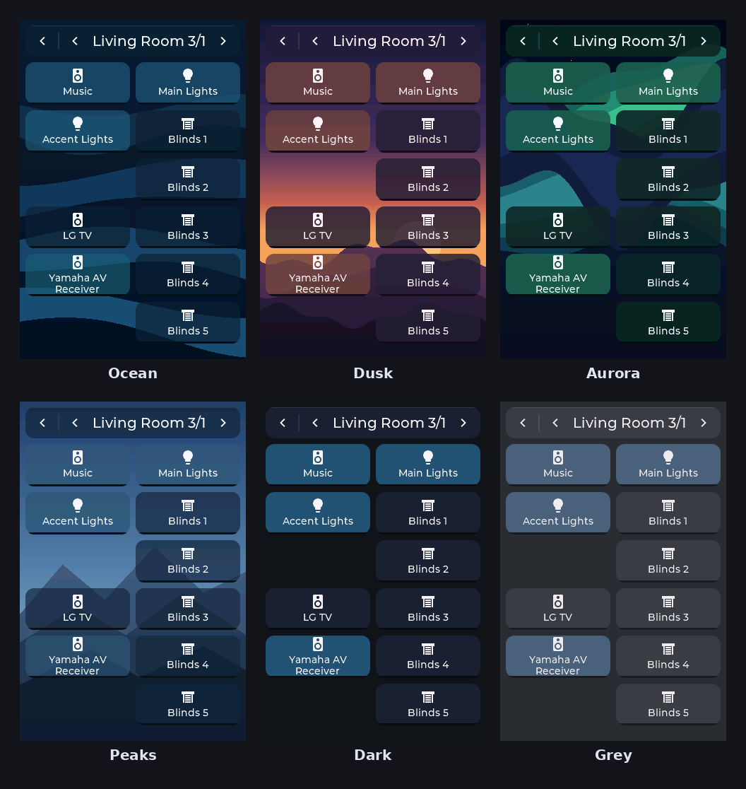
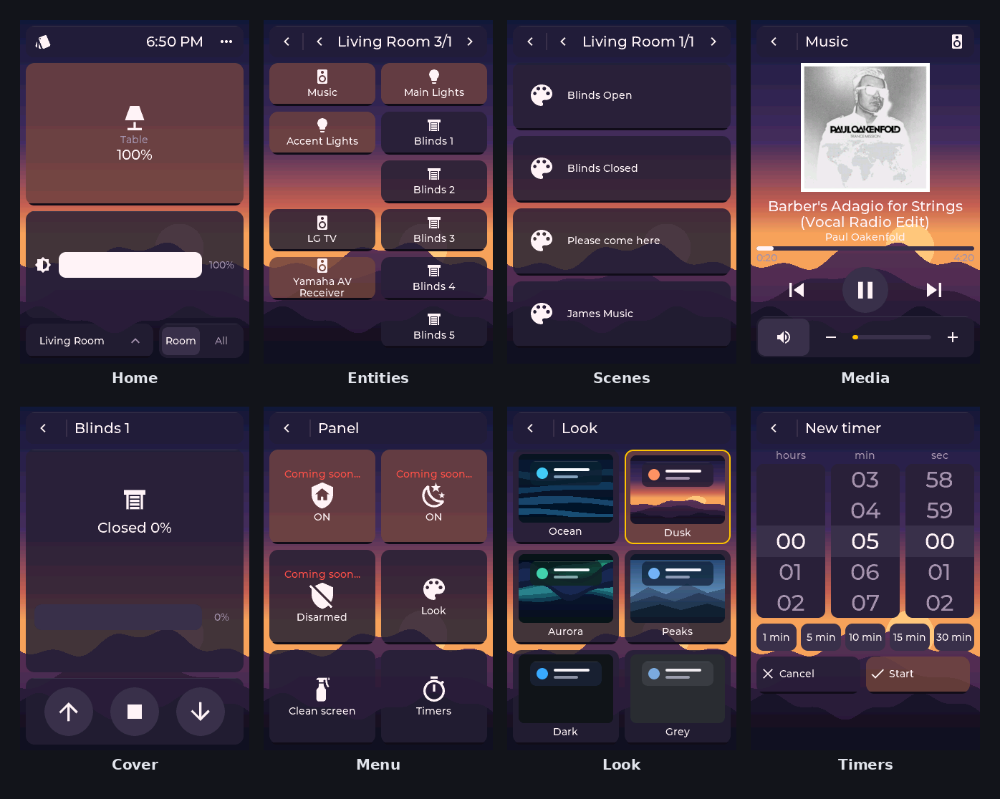
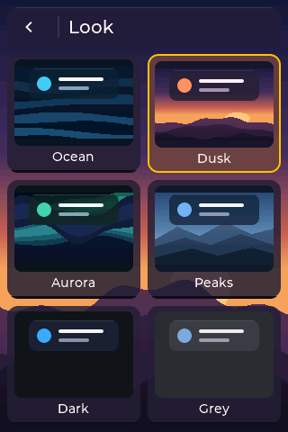
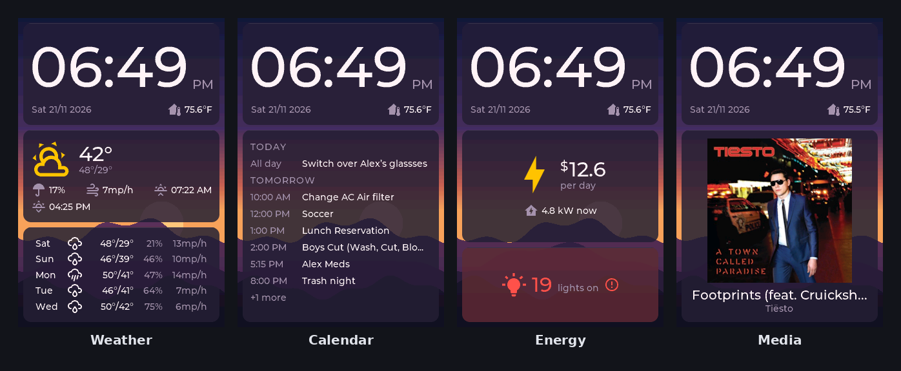
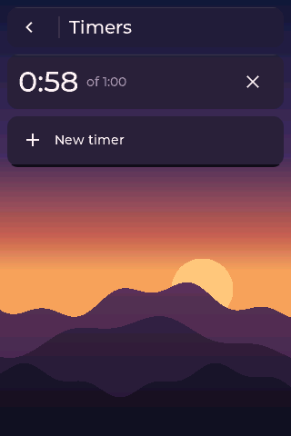

# NSPanelManager, the fork

> **This is a fork** of [NSPManager/NSPanelManager](https://github.com/NSPManager/NSPanelManager), maintained
> by [@jamesmulcahy](https://github.com/jamesmulcahy). It is not affiliated with or endorsed by the upstream
> project. Upstream's [documentation](https://nspanelmanager.com) and [Discord](https://discord.gg/RwXvAH56fE)
> cover the shared basics; for anything specific to this fork, open an issue here rather than there.
>
> The fork's work lives on the `fork` branch, with the matching firmware in
> [jamesmulcahy/NSPanelManager-firmware](https://github.com/jamesmulcahy/NSPanelManager-firmware).
> The Nextion pages are still supported today but are being dropped soon: **LVGL is the path forward.**

The fork's focus is **low latency and reliability**. It replaces the Nextion pages with a UI drawn by the panel
itself (LVGL), and builds more on top of it: screensaver cards, themes, timers, media players, and Home
Assistant room sync to make configuring a house easy.

**One thing to update.** The LVGL UI and the setup web UI are part of the firmware, and the fork no longer
ships a LittleFS image. So the main firmware is the only thing you ever upgrade, and a firmware update takes
one reboot.

## What's different

### An LVGL UI instead of Nextion pages

One UI written in code, so there is no per-theme bitmap set to render and flash. It adapts to both the US and
EU panel shapes. The panel serves its own screen as an image at `GET /screenshot`, which is how the pictures
on this page were taken.

Pages are reached by swiping down for the menu from any page, and tapping through rooms, entities and scenes.

### Themes and backgrounds

Six looks: **Ocean**, **Dusk**, **Aurora** and **Peaks** (a background with a palette tinted to match), plus
plain **Dark** and **Grey**. Choose one on the panel from the swipe-down menu, or per panel in the manager's
settings. The panel saves it and tells the manager.

### Screensaver cards

The screensaver is a clock with a card that turns every ten seconds, or by swiping:

- **Weather**, with today's details and a five-day forecast
- **Calendar**, from any of your Home Assistant calendars, with a picker for which ones
- **Energy**, with today's cost and the house's current draw
- **Now playing**, with the room's album art, title and artist (shown while something is playing)

### Timers

Start a timer from the menu with the hour, minute and second wheels or a one-tap preset. Running timers are
listed on the panel, and a finished timer sounds an alarm. The manager has a setting and an event for the
timer-finished sound.

### Home Assistant room sync

Setting up rooms by hand is the slow part of a new install. Link a room to a Home Assistant area, then use the
*Sync from Home Assistant* page to see the entities Home Assistant has in that area and import them in bulk,
already placed in the right room.

### Also in the fork

- **Media players** with album art, transport controls and volume, and the multi-room audio improvements.
- **Covers**, with open, stop and close controls and a position slider.
- **Panel clock** from the container's timezone, and a **temperature sensor** that reports in your unit.
- **Reliable updates**: one reboot per firmware update, with bounded retries and checksum checks.
- **Firmware from GitHub**: pick the firmware release the manager serves from the settings.
- **Metrics**: Prometheus metrics and Grafana dashboards for the manager and the whole fleet of panels.
- **A self-contained dev stack** and QEMU tests that run the real firmware against the real manager in CI.

## Installing the fork

Run the manager from the fork's Docker image, `jamesmulcahy/nspanelmanager:fork-latest`, and flash panels with
firmware from the
[fork's firmware releases](https://github.com/jamesmulcahy/NSPanelManager-firmware/releases). The image ships
that firmware, so a panel can be switched to LVGL from its settings page in the manager.

---

# NSPanelManager (upstream's introduction)

Standardised Smart Home control for Home Assistant and Openhab users using the original Sonoff NSPanel.

NSPanel Manager is a custom software solution for the Sonoff NSPanel (not the NSPanel pro).
The software is designed to be easy to use on a day-to-day basis and to easily manage multiple NSPanels around
your home.

The interface on the NSPanel itself has been designed to be intuitive to use for people of all ages and backgrounds.

All the NSPanels that are installed with the NSPanel Manager solution communicate back to a Docker container that is
used to manage the panels, NSPanel Manager specific solutions and also all communication back and forth to/from
Home Assistant and/or OpenHAB.

# Complete walkthrough and installation guide on Youtube:

# Slides of custom GUI for NSPanel

https://github.com/user-attachments/assets/a0bf2858-8384-4e67-b25e-44e3d41ccfa6

# Manager Web UI click-through

https://github.com/user-attachments/assets/18ea4fe1-7b48-4b8e-a950-67c87f76b6e9

# More information

All information about this project on how it works and how to use it is available at https://nspanelmanager.com

# Further questions or discussion?

Head over to our [Discord](https://discord.gg/RwXvAH56fE)!

# Support

